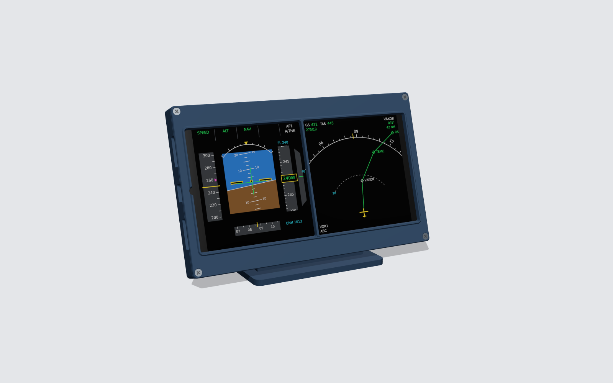
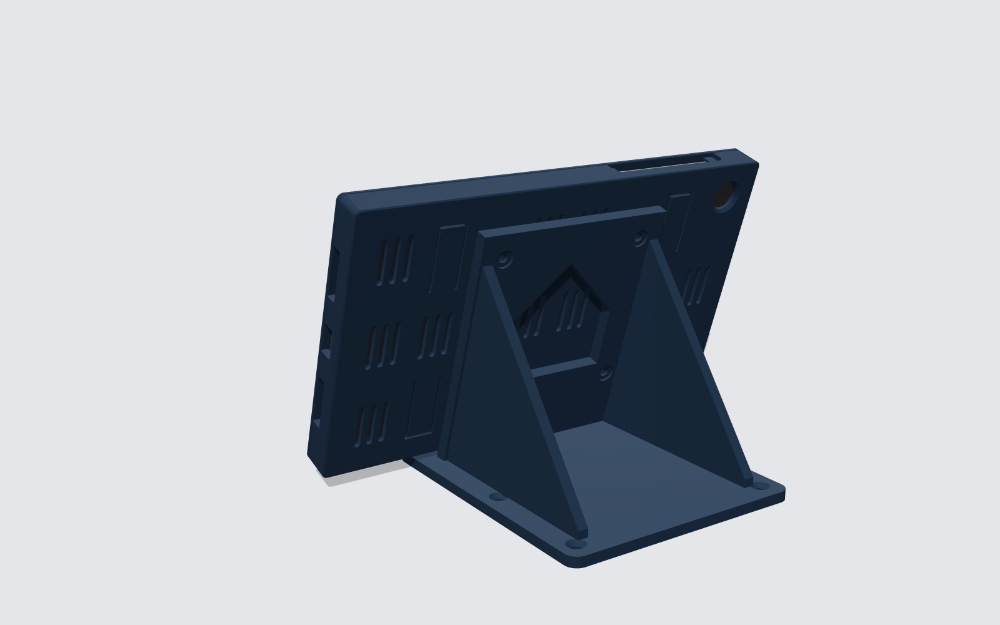
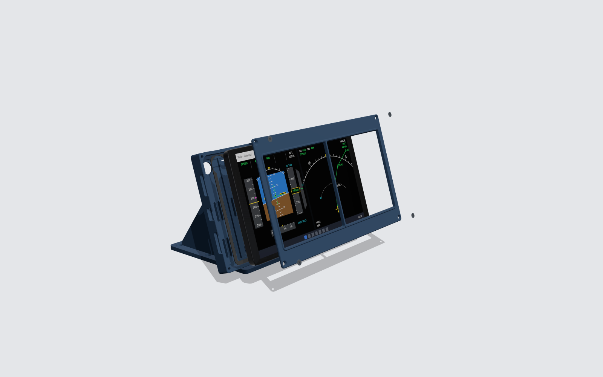

# A320-style dual PFD / ND housing — Samsung Galaxy Tab A11 (8.7")

A fully parametric, 3D-printable case that holds a Galaxy Tab A11 in landscape and turns its single screen into two Airbus-style flight displays:
- **PFD** on the left and **ND** on the right, split by a raised 3 mm divider.
- A 15 mm top border hides the Windows pop-out title bars, and a 15 mm bottom border hides the taskbar.



| Rear (on the desk stand) | Exploded |
|---|---|
|  |  |

## What's here

| Path | Contents |
|---|---|
| `cad/a320_tab_a11_housing.scad` | The editable, fully parametric OpenSCAD model (single file) |
| `stl/front_bezel_PLA.stl` | Front bezel: PFD/ND windows, divider, raised display surround |
| `stl/rear_housing_PLA.stl` | Rear protective housing: springs, vents, port notches, VESA 75 nut traps |
| `stl/desk_stand_PLA.stl` | Modular desk stand, 17.5° recline, bolts on through VESA 75 |
| `stl/tpu_liner_TPU_optional.stl` | Optional TPU protective back pads |
| `stl/fit_test_ring_PLA_optional.stl` | Quick fit check: outline, screws and all edge openings |
| `stl/assembly_combined_view_only.stl` | Everything assembled on the stand (for viewing, not printing) |
| `renders/` | Front, three-quarter, rear, rear-case, exploded and divider-detail previews |
| `docs/technical_drawing.pdf` | Two dimensioned A3 sheets (PNG copies alongside); front view at 1:1 |
| `docs/ASSEMBLY.md` | Short assembly guide, print settings and display set-up |
| `docs/verification_report.md` | Automated geometry checks: all pass |
| `docs/calibration_1340x800.png` | Full-screen test image to check bezel alignment on the tablet |
| `tools/` | Build, verification, drawing and render scripts |

## Key dimensions (defaults)

| | |
|---|---|
| Tablet (nominal) | 211.0 × 124.7 × 8.0 mm, corner R8 (assumed), 1340 × 800 px |
| Clearance | 0.6 mm per side around the tablet, 0.4 mm depth play taken up by springs |
| Borders (coverage from the tablet edge) | **top 15.0, bottom 15.0, left 5.0, right 5.0 mm** |
| Visible frame band (adds 0.6 clearance + 3.5 wall) | 19.1 mm top/bottom, 9.1 mm sides |
| Windows | 2 × 99.0 × 94.7 mm at the glass, exact mirror images |
| Divider | 3.0 mm at the glass, 2.2 mm at the face, 3.4 mm tall; centred on the screen |
| Overall | 219.2 × 132.9 × 18.0 mm |
| Visible pixels | PFD x 0–659, ND x 681–1340, rows 66–734 (≈ 659 × 668 px each) |
| Mounting | VESA 75 × 75 (M4) on a flat rear face, plus the desk stand (15–20°, default 17.5°) |
| Colour | #263B50 matte Airbus-style blue-grey |

**Border measurement:** the borders are measured on the glass from the **tablet edge**, because that is what hides the title bars and taskbar. The case wall then adds 4.1 mm to the band you see from the front. Set `border_datum = "outer"` to measure the borders from the outside edge of the case instead.

## Design notes

- **Front bezel prints face-up.** Its flat back goes on the bed and sits on the glass, so the raised display surround (+0.8 mm) and the divider crown (+0.4 mm) print without supports. The window edges open towards the front (1.0 mm, divider 0.4 mm), so no ledge casts a shadow on the instruments.
- **Retention without fragile clips:**
  - Four M3 countersunk screws at the corners, styled like panel fasteners.
  - Four PLA leaf springs moulded into the back plate press the tablet against the bezel with 0.5 mm preload. This works with or without the TPU liner.
  - Eight small ribs centre the tablet in the 0.6 mm clearance.
- **Ports:** USB-C, 3.5 mm jack/mic, four speaker slots and the power/volume keys (with a finger relief) are notches open towards the bezel. They print without bridges and leave the charging port fully clear.
- **Cameras:** there is a 14 mm rear camera hole and a front camera notch.
- **Ventilation:** a 3 mm air gap behind the tablet with vertical channels and 45 rear slots arranged as a chimney (low intake, high exhaust).
- **Modular mounting:** the housing only has a flat back with VESA 75 nut traps. The desk stand is a separate part, and any monitor arm or cockpit bracket fits the same holes.
- **Printability:** no part needs supports. No adhesive is needed. Every part is a single watertight manifold.

## Rebuilding / customising

Measure your tablet and edit the parameter block at the top of the `.scad`. It is grouped as:
- Tablet, Tolerances, Borders, Housing, Bezel styling
- Screws, Retention, Ventilation, Mounting, Desk stand
- Orientation / openings (the `ports` table)

```bash
python3 tools/build.py                      # export all STLs + build/info.json (needs OpenSCAD)
python3 tools/build.py -D tab_r=10 -D wall=3.8   # same, with overrides
python3 tools/verify.py                     # geometry checks -> docs/verification_report.md
cd tools && npm install && node render.mjs  # preview renders (three.js + Playwright Chromium)
python3 tools/drawing.py                    # dimensioned drawing -> docs/technical_drawing.pdf
python3 tools/calibration.py                # screen calibration image
```

Python requirements: `numpy trimesh manifold3d shapely matplotlib pillow`.

Before printing the full housing, print the fit-test ring and confirm these on your own unit:
- the tablet corner radius `tab_r`, which is assumed to be 8 mm;
- the edge-opening positions in `ports`, which are best estimates for the Tab A11.

The displays shown in the renders are simplified, generic mock-ups for illustration only.
